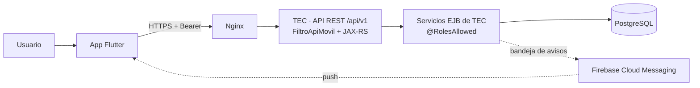
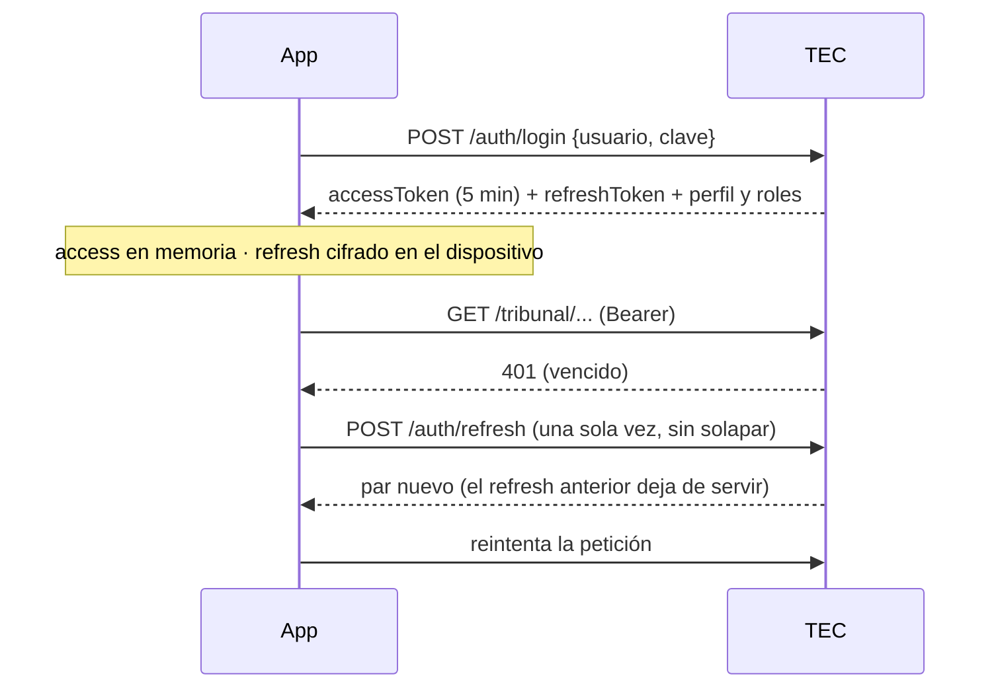

# App CONPOCIIECH

Aplicación móvil institucional de CONPOCIIECH (Android e iOS). Su módulo **Tribunal
Electoral** es una extensión móvil del sistema web **TEC**: consulta y opera el proceso
electoral según el rol del usuario, siempre a través de la API de TEC, que autoriza cada
petición.

| Dato | Valor |
| --- | --- |
| Paquete Android / bundle iOS | `ec.org.conpociiech.app` |
| Versión | `pubspec.yaml` → `version: 1.0.0+1` (`versionName+versionCode`) |
| Plataformas | Android (minSdk de Flutter, 24+) e iOS |
| Flutter / Dart | 3.44 estable / 3.12 |
| Backend | TEC — `https://tribunal.conpociiech.org/api/v1` |
| Contrato de la API | `docs/api-movil.md` del repositorio de TEC |

---

## 1. Visión general



- **TEC es la fuente de verdad** de usuarios, roles, iglesias, personas, padrón, procesos,
  JRV, mesas, actas y escrutinio. La App no duplica reglas electorales.
- **Toda autorización ocurre en TEC.** La App oculta lo que el rol no puede usar solo por
  usabilidad: ocultar una opción no es seguridad.
- **El alcance lo decide TEC**, nunca la App: la mesa del Presidente sale de su designación
  JRV, la iglesia del IglesiaAdmin de su usuario, y todo se filtra por el proceso activo.
- **Solo en línea.** Cada paso se guarda en TEC al momento; no se guardan datos electorales
  en el teléfono.

---

## 2. Estructura del código

```
lib/
  main.dart                     Arranque: entorno (--dart-define), Firebase opcional y App
  app.dart                      Raíz: proveedores, router, ciclo de vida y avisos push
  core/                         Infraestructura sin pantallas
    api/cliente_api.dart        Cliente HTTP de TEC: JSON, archivos, errores, tiempos de espera
    config/entorno.dart         API_BASE_URL (solo HTTPS)
    router/app_router.dart      Rutas (go_router) y guardas por sesión, cambio de clave y rol
    sesion/
      api_autenticacion.dart    Endpoints /auth/* y modelos de sesión y perfil
      almacen_tokens.dart       Refresh token cifrado (Keystore / Keychain)
      sesion_controller.dart    Estado de sesión: tokens, renovación, inactividad, cierre
      roles.dart                Roles de TEC y secciones del módulo por rol
    push/
      proveedor_push.dart       Firebase Cloud Messaging (o inactivo si no está configurado)
      controlador_push.dart     Registro del dispositivo en TEC y avisos recibidos/tocados
  shared/                       Reutilizable por cualquier módulo
    tema/                       Colores y tipografía del tema Tribunal (Montserrat)
    widgets/                    Logo institucional
  features/                     Un directorio por módulo
    inicio/                     Área pública
    auth/                       Inicio de sesión y cambio de clave
    tribunal/                   Módulo Tribunal Electoral (área autenticada)
      api_tribunal.dart         Endpoints /tribunal/* y sus modelos
      widgets_tribunal.dart     Carga con reintento, secciones, indicadores, estados
      pantalla_tribunal.dart    Panel: secciones según los roles del usuario
      presidente/               Mi mesa, padrón y escrutinio (Presidente de mesa)
      iglesia/                  Mi iglesia, miembros y habilitación (IglesiaAdmin)
      proceso/                  Resumen, alertas, avance, detalle de mesa, revisión de actas
                                y resultados (Tribunal y Administrador)
test/
  tec_simulado.dart             TEC simulado (MockClient) con las reglas del contrato
  sesion_controller_test.dart   Sesión: tokens, renovación, inactividad, cambio de clave
  app_test.dart                 Navegación, guardas e inicio de sesión
  tribunal_test.dart            Consultas por rol, miembros, pendientes, habilitación
  escrutinio_test.dart          Apertura, conteo, cierre y foto del acta
  revision_acta_test.dart       Alertas, detalle de mesa y revisión del acta
  push_test.dart                Registro del dispositivo y avisos
branding/                       Fuentes del icono y del splash (no se empaquetan)
assets/                         Logo y fuentes Montserrat empaquetados
docs/release-android.md         Firma, versionado, App Bundle y Google Play
```

**Dependencias principales:** `provider` (estado), `go_router` (navegación con guardas),
`http` (API), `flutter_secure_storage` (refresh cifrado), `image_picker` (foto del acta),
`firebase_core` y `firebase_messaging` (avisos push, opcionales).
De desarrollo: `flutter_lints`, `flutter_launcher_icons`, `flutter_native_splash`.

### Capas

| Capa | Responsabilidad | No hace |
|---|---|---|
| `features/*` (pantallas) | Mostrar, validar formularios, confirmar acciones | Reglas electorales ni permisos reales |
| `features/tribunal/api_tribunal.dart` | Traducir endpoints a modelos Dart | Decidir el alcance (mesa, iglesia) |
| `core/sesion` | Tokens, renovación, inactividad, cierre | Guardar la contraseña |
| `core/api` | HTTP, errores `{codigo, mensaje}`, sin conexión | Registrar cuerpos, cabeceras ni tokens |
| `core/router` | Qué pantalla corresponde a la sesión y al rol | Sustituir la autorización de TEC |

---

## 3. Sesión y seguridad



- **Tokens opacos emitidos por TEC.** El de acceso (5 min) vive solo en memoria. El refresh
  rota en cada uso y se guarda cifrado (Android Keystore / iOS Keychain, sin copia en otro
  dispositivo). Reutilizar un refresh ya usado revoca la sesión en TEC.
- **La contraseña nunca se guarda**; el campo se limpia tras cada intento.
- **Inactividad de 15 minutos**, como la web: la sesión se cierra en la siguiente
  interacción o al volver a la App. Con actividad en pantalla y sin peticiones, la App
  renueva para que TEC no la expire.
- **Ante un 401** renueva una vez; si TEC rechaza la renovación, cierra con aviso.
- **Usuario no permanente:** solo ve el cambio de clave hasta realizarlo (misma política de
  la web: 8 a 16 caracteres, sin espacios, mayúscula, minúscula y número).
- **Cerrar sesión:** primero da de baja el dispositivo para avisos y luego revoca la sesión
  en TEC; lo local se borra aunque no haya conexión.
- **Transporte:** solo HTTPS (`usesCleartextTraffic="false"`, ATS en iOS); la App no
  desactiva la validación TLS. Sin copia de seguridad automática (`allowBackup="false"`).
- **Datos mínimos:** las respuestas no traen cédulas, correos ni datos de contacto.

---

## 4. Navegación y guardas

| Ruta | Pantalla | Exige |
|---|---|---|
| `/` | Inicio público | — |
| `/iniciar-sesion?destino=` | Inicio de sesión | — (si ya hay sesión, va al destino) |
| `/cambiar-clave` | Cambio de clave | Sesión |
| `/tribunal` | Panel del módulo | Sesión y un rol del módulo |
| `/tribunal/mesa` · `/padron` · `/escrutinio` | Mi mesa, padrón, escrutinio | Presidente-mesa |
| `/tribunal/iglesia` · `/miembros?pendientes=1` | Mi iglesia, miembros | IglesiaAdmin |
| `/tribunal/proceso` · `/mesas` · `/mesas/:mesaId` · `/resultados` | Resumen, avance, detalle, resultados | Administrador o Tribunal |

`guardaRutas` (en `app_router.dart`), en orden:
1. Cambio de clave obligatorio → solo `/cambiar-clave`.
2. Sin sesión en una ruta protegida → inicio de sesión con `destino`.
3. Sin un rol del módulo → inicio; sin el rol de la sección → panel del módulo.

Un usuario con varios roles ve la **unión** de sus secciones. Los destinos tras iniciar
sesión o al tocar un aviso solo aceptan rutas internas conocidas (`destinoSeguro`).

---

## 5. Funcionalidades por rol

Roles de TEC con acceso al módulo: `SITEC-Presidente-mesa`, `SITEC-IglesiaAdmin`,
`SITEC-Tribunal` y `SITEC-Administrador`. Los demás roles (Técnico, Gerencial, Supervisor,
Superadministrador) pueden iniciar sesión pero no ven el módulo, y TEC los rechaza con 403.

### Presidente de mesa — «Mi mesa»
- Datos de su mesa, estado del escrutinio, junta y resultados (solo con la mesa cerrada).
- Padrón con búsqueda por nombre o iglesia.
- **Escrutinio:** apertura (TEC informa si la junta, el padrón o los documentos la
  bloquean) → conteo por categoría con el cuadre de papeletas en vivo, guardado como
  borrador → cierre con confirmación (exige el conteo guardado) → foto del acta física
  (cámara o galería, JPEG hasta 10 MB) → seguimiento de la revisión. Si el Tribunal la
  devuelve, la mesa queda reabierta para corregir y volver a cerrar.

### IglesiaAdmin — «Mi iglesia»
- Datos de su iglesia y resumen de miembros (habilitados, información completa,
  pendientes de revisión, también en otra iglesia).
- Miembros por páginas, con búsqueda y filtros de habilitación y **pendientes de revisión**.
- **Habilitación para participar:** interruptor con confirmación, solo en la fase del
  cronograma que lo permite; el cambio marca al miembro como revisado, igual que la web.

### Tribunal y Administrador — «Proceso electoral»
- Alertas del proceso (las del dashboard web) y resumen: fase, iglesias, recintos, mesas,
  electores, juntas completas y mesas cerradas.
- Avance de mesas con filtros por cantón, recinto y estado.
- Detalle de mesa: junta, conteo, cuadre, acta física y su foto con zoom.
- Resultados consolidados por lista.
- **Revisión del acta física, solo el Tribunal:** validar como dato oficial (tras confirmar
  que coincide con lo registrado) u observar/rechazar con motivo, que devuelve la mesa al
  Presidente. El Administrador consulta pero no revisa (regla aplicada en TEC, también en la
  web).

### Todos
Cambiar la contraseña y cerrar sesión.

---

## 6. Endpoints de TEC que consume la App

| Área | Endpoints (`/api/v1`) |
|---|---|
| Sesión | `POST /auth/login`, `POST /auth/refresh`, `GET /auth/yo`, `POST /auth/cambiar-clave`, `POST /auth/logout` |
| Presidente | `GET /tribunal/presidente/mesa`, `GET /tribunal/presidente/padron`, `GET\|POST\|PUT /tribunal/presidente/acta` (`/apertura`, `/conteo`, `/cierre`, `/acta-fisica`) |
| IglesiaAdmin | `GET /tribunal/iglesia`, `GET /tribunal/iglesia/miembros`, `PUT /tribunal/iglesia/miembros/{id}/habilitacion` |
| Tribunal / Administrador | `GET /tribunal/proceso/resumen`, `GET /tribunal/proceso/mesas`, `GET /tribunal/proceso/mesas/{id}`, `GET /tribunal/proceso/mesas/{id}/acta-fisica`, `POST …/acta-fisica/validacion`, `POST …/acta-fisica/devolucion`, `GET /tribunal/proceso/resultados` |
| Avisos | `POST /dispositivos`, `POST /dispositivos/baja` |

Errores: `{codigo, mensaje}`; la App muestra `mensaje` (lo redacta TEC en español). Sin
respuesta del servidor muestra «No se pudo conectar con el sistema TEC».

---

## 7. Notificaciones push

Desactivadas mientras no se configure Firebase: sin las opciones la App funciona igual y no
pide permiso de notificaciones. No se versiona `google-services.json` ni
`GoogleService-Info.plist`; las opciones se pasan al compilar:

```bash
flutter build appbundle --release \
  --dart-define=FIREBASE_API_KEY=... --dart-define=FIREBASE_PROJECT_ID=... \
  --dart-define=FIREBASE_SENDER_ID=... --dart-define=FIREBASE_APP_ID_ANDROID=... \
  --dart-define=FIREBASE_APP_ID_IOS=...
```

| Aviso | Destinatario |
|---|---|
| Acta física validada, observada o rechazada | Presidente de esa mesa |
| Mesa cerrada | Tribunal y Administrador |
| Inicio de una fase del cronograma | IglesiaAdmin |
| Inicio y fin del sufragio | Presidentes de mesa |

- Contenido mínimo, sin datos personales; el detalle se ve al abrir la App con sesión.
- Con sesión completa la App registra el token del dispositivo en TEC, lo vuelve a
  registrar si Firebase lo renueva y lo da de baja al cerrar sesión.
- Con la App abierta el aviso se muestra con «Ver»; al tocarlo se abre la pantalla
  indicada, siempre a través de la guarda de rutas.
- En iOS: activar en Xcode *Push Notifications* y *Background Modes → Remote
  notifications*, y subir la clave APNs en Firebase. En TEC: migración V12,
  `-Dtec.push.enabled=true` y la cuenta de servicio (ver `docs/api-movil.md` de TEC).

---

## 8. Ejecutar, probar y compilar

```bash
flutter pub get
flutter analyze
flutter test
flutter run
```

`API_BASE_URL` es opcional (por defecto producción) y **debe ser https**: la App no
arranca con una URL insegura. Contra el entorno local:

```bash
flutter run --dart-define=API_BASE_URL=https://tribunal.local/api/v1
```

El dispositivo o emulador debe resolver `tribunal.local` y confiar en su certificado.

**Pruebas:** corren contra `test/tec_simulado.dart`, que reproduce los endpoints y reglas
del contrato (roles, rotación del refresh, sesión restringida, transiciones del escrutinio,
revisión del acta). No necesitan red ni TEC.

**APK:**

```bash
flutter build apk --debug
flutter build apk --release --split-per-abi
```

El release exige `android/key.properties` y la llave de firma (no se versionan; sin ellas
el build falla a propósito). Pasos completos en [docs/release-android.md](docs/release-android.md).

---

## 9. Identidad

- Tema Tribunal de TEC (`shared/tema/`): azul institucional `#034EA2` y Montserrat
  400/500/700 (licencia OFL en `assets/fonts/OFL.txt`).
- **Provisional con el logo TEC:** `assets/branding/logo_tec_provisional.png`, icono y
  splash (fuentes en `branding/`, configuración en `flutter_launcher_icons.yaml` y
  `flutter_native_splash.yaml`). Con el logo oficial de CONPOCIIECH, reemplazar esas
  imágenes y ejecutar:

```bash
dart run flutter_launcher_icons
dart run flutter_native_splash:create
```

---

## 10. Cómo extender

- **Nueva consulta del módulo Tribunal:** endpoint en TEC con `@RolesAllowed` y alcance
  desde el principal → método en `api_tribunal.dart` → pantalla en la sección del rol →
  ruta en `app_router.dart` (hereda la guarda de su sección) → simulación en
  `tec_simulado.dart` y pruebas.
- **Nuevo módulo CONPOCIIECH:** `features/<modulo>/`, sus rutas y, si es protegido, su
  guarda en `guardaRutas`.
- **Nuevo rol con funciones:** definir sus permisos en TEC primero; en la App, agregarlo a
  `RolTec` y a `Rutas.rolesPorSeccion`.

---

## 11. Estado

| Fase | Estado |
|---|---|
| 1. Base Flutter (estructura, tema, guardas) | Completada |
| 2. Identidad | Provisional con el logo TEC; pendiente el logo oficial |
| 3. API de autenticación en TEC | Completada |
| 4. Sesión y roles en la App | Completada |
| 5. Módulo Tribunal (consultas por rol) | Implementada; pendiente validar con datos reales |
| 6. Acciones (habilitación, escrutinio, revisión de actas, avisos push) | Implementada; pendiente validar con datos reales y configurar Firebase |
| 7. Pruebas y seguridad | Pruebas de la App y de autorización en TEC (`mvn -Pqr-tests test`); pendiente la revisión de seguridad integral |
