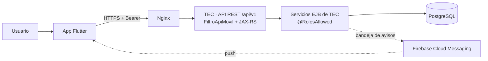
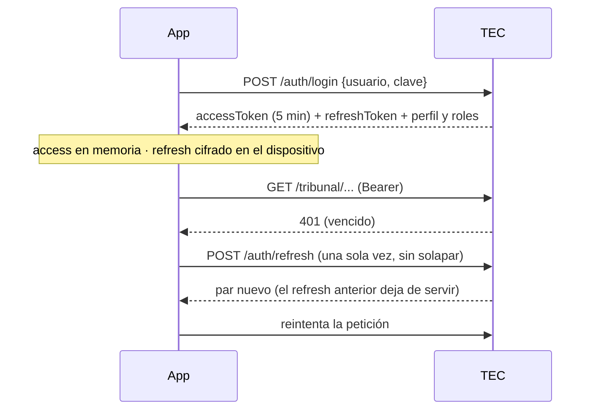

# App CONPOCIIECH

Aplicación móvil institucional de CONPOCIIECH (Android e iOS). Su módulo **Tribunal
Electoral** es una extensión móvil del sistema web **TEC**: consulta y opera el proceso
electoral según el rol del usuario, siempre a través de la API de TEC, que autoriza cada
petición.

| Dato | Valor |
| --- | --- |
| Paquete Android / bundle iOS | `ec.org.conpociiech.app` |
| Versión | `pubspec.yaml` → `version: 1.0.0+1` (`versionName+versionCode`) |
| Plataformas | Android (minSdk de Flutter, 24+) e iOS |
| Flutter / Dart | 3.44 estable / 3.12 |
| Backend | TEC — `https://tribunal.conpociiech.org/api/v1` |
| Contrato de la API | `docs/api-movil.md` del repositorio de TEC |

---

## 1. Visión general



- **TEC es la fuente de verdad** de usuarios, roles, iglesias, personas, padrón, procesos,
  JRV, mesas, actas y escrutinio. La App no duplica reglas electorales.
- **Toda autorización ocurre en TEC.** La App oculta lo que el rol no puede usar solo por
  usabilidad: ocultar una opción no es seguridad.
- **El alcance lo decide TEC**, nunca la App: la mesa del Presidente sale de su designación
  JRV, la iglesia del IglesiaAdmin de su usuario, y todo se filtra por el proceso activo.
- **Solo en línea.** Cada paso se guarda en TEC al momento; no se guardan datos electorales
  en el teléfono.

---

## 2. Estructura del código

```
lib/
  main.dart                     Arranque: entorno (config/*.json), Firebase opcional y App
  app.dart                      Raíz: proveedores, router, ciclo de vida y avisos push
  core/                         Infraestructura sin pantallas
    api/cliente_api.dart        Cliente HTTP de TEC: JSON, archivos, errores, tiempos de espera
    config/entorno.dart         AMBIENTE y API_BASE_URL (solo HTTPS): única configuración
    router/app_router.dart      Rutas (go_router) y guardas por sesión, cambio de clave y rol
    sesion/
      api_autenticacion.dart    Endpoints /auth/* y modelos de sesión y perfil
      almacen_tokens.dart       Refresh token cifrado (Keystore / Keychain)
      sesion_controller.dart    Estado de sesión: tokens, renovación, inactividad, cierre
      roles.dart                Roles de TEC y secciones del módulo por rol
    push/
      proveedor_push.dart       Firebase Cloud Messaging (o inactivo si no está configurado)
      controlador_push.dart     Registro del dispositivo en TEC y avisos recibidos/tocados
  shared/                       Reutilizable por cualquier módulo
    tema/                       Tema Material 3, colores, Montserrat y tokens responsive
      diseno_app.dart           Espaciado, radios, breakpoints y ancho máximo de contenido
    widgets/                    Logo, encabezado, estados y estructura adaptativa
      estructura_principal.dart Pestañas Inicio · Organización · Servicios (área pública)
      estructura_adaptativa.dart NavigationBar / NavigationRail según ancho y roles
      componentes_institucionales.dart Encabezado, tarjeta de sección y de servicio
      entrada_animada.dart      Entrada suave (respeta «reducir animaciones»)
      logo_institucional.dart   Logo de CONPOCIIECH y logo del TEC
      estados_app.dart          Carga, vacío y error con reintento
      cabecera_app.dart         Encabezado reutilizable
  features/                     Un directorio por módulo
    inicio/                     Inicio público
    organizacion/               Organización y contenido institucional publicado
    servicios/                  Servicios electorales y cuenta
    auth/                       Inicio de sesión y cambio de clave
    tribunal/                   Módulo Tribunal Electoral (área autenticada)
      api_tribunal.dart         Endpoints /tribunal/* y sus modelos
      widgets_tribunal.dart     Carga con reintento, secciones, indicadores, estados
      pantalla_tribunal.dart    Panel: secciones según los roles del usuario
      presidente/               Mi mesa, padrón y escrutinio (Presidente de mesa)
        guia_escrutinio.dart     Guía del flujo y aviso de cambios pendientes de guardar
      iglesia/                  Mi iglesia, miembros, habilitación y datos de la persona (IglesiaAdmin)
      proceso/                  Resumen, alertas, avance, detalle de mesa, revisión de actas
                                y resultados (Tribunal y Administrador)
test/
  tec_simulado.dart             TEC simulado (MockClient) con las reglas del contrato
  sesion_controller_test.dart   Sesión: tokens, renovación, inactividad, cambio de clave
  app_test.dart                 Navegación, guardas e inicio de sesión
  navegacion_institucional_test.dart Pestañas, Organización y accesos desde Servicios
  tribunal_test.dart            Consultas por rol, miembros, pendientes, habilitación
  escrutinio_test.dart          Apertura, conteo, cierre y foto del acta
  revision_acta_test.dart       Alertas, detalle de mesa y revisión del acta
  push_test.dart                Registro del dispositivo y avisos
  responsive_test.dart          Pantallas, navegación y layout en seis anchos y dos escalas de texto
branding/                       Fuentes del icono y del splash (no se empaquetan)
assets/                         Logo y fuentes Montserrat empaquetados
docs/release-android.md         Firma, versionado, App Bundle y Google Play
docs/modernizacion-ui.md        Auditoría UI, componentes, validación y pendientes de TEC
```

**Dependencias principales:** `provider` (estado), `go_router` (navegación con guardas),
`http` (API), `flutter_secure_storage` (refresh cifrado), `image_picker` (foto del acta),
`firebase_core` y `firebase_messaging` (avisos push, opcionales).
De desarrollo: `flutter_lints`, `flutter_launcher_icons`, `flutter_native_splash`.

### Capas

| Capa | Responsabilidad | No hace |
|---|---|---|
| `features/*` (pantallas) | Mostrar, validar formularios, confirmar acciones | Reglas electorales ni permisos reales |
| `features/tribunal/api_tribunal.dart` | Traducir endpoints a modelos Dart | Decidir el alcance (mesa, iglesia) |
| `core/sesion` | Tokens, renovación, inactividad, cierre | Guardar la contraseña |
| `core/api` | HTTP, errores `{codigo, mensaje}`, sin conexión | Registrar cuerpos, cabeceras ni tokens |
| `core/router` | Qué pantalla corresponde a la sesión y al rol | Sustituir la autorización de TEC |

---

## 3. Sesión y seguridad



- **Tokens opacos emitidos por TEC.** El de acceso (5 min) vive solo en memoria. El refresh
  rota en cada uso y se guarda cifrado (Android Keystore / iOS Keychain, sin copia en otro
  dispositivo). Reutilizar un refresh ya usado revoca la sesión en TEC.
- **La contraseña nunca se guarda**; el campo se limpia tras cada intento.
- **Inactividad de 15 minutos**, como la web: la sesión se cierra en la siguiente
  interacción o al volver a la App. Con actividad en pantalla y sin peticiones, la App
  renueva para que TEC no la expire.
- **Ante un 401** renueva una vez; si TEC rechaza la renovación, cierra con aviso.
- **Usuario no permanente:** solo ve el cambio de clave hasta realizarlo (misma política de
  la web: 8 a 16 caracteres, sin espacios, mayúscula, minúscula y número).
- **Cerrar sesión:** primero da de baja el dispositivo para avisos y luego revoca la sesión
  en TEC; lo local se borra aunque no haya conexión.
- **Transporte:** solo HTTPS (`usesCleartextTraffic="false"`, ATS en iOS); la App no
  desactiva la validación TLS. Sin copia de seguridad automática (`allowBackup="false"`).
- **Datos mínimos:** las respuestas no traen cédulas, correos ni datos de contacto.

---

## 4. Navegación y guardas

| Ruta | Pantalla | Exige |
|---|---|---|
| `/` | Inicio (pestaña) | — |
| `/organizacion` | Organización (pestaña) | — |
| `/servicios` | Servicios (pestaña): acceso al TEC y cuenta | — |
| `/iniciar-sesion?destino=` | Inicio de sesión | — (si ya hay sesión, va al destino) |
| `/cambiar-clave` | Cambio de clave | Sesión |
| `/tribunal` | Panel del módulo | Sesión y un rol del módulo |
| `/tribunal/mesa` · `/padron` · `/escrutinio` | Mi mesa, padrón, escrutinio | Presidente-mesa |
| `/tribunal/iglesia` · `/miembros?pendientes=1` | Mi iglesia, miembros | IglesiaAdmin |
| `/tribunal/proceso` · `/mesas` · `/mesas/:mesaId` · `/resultados` | Resumen, avance, detalle, resultados | Administrador o Tribunal |

`guardaRutas` (en `app_router.dart`), en orden:
1. Cambio de clave obligatorio → solo `/cambiar-clave`.
2. Sin sesión en una ruta protegida → inicio de sesión con `destino`.
3. Sin un rol del módulo → inicio; sin el rol de la sección → panel del módulo.

Un usuario con varios roles ve la **unión** de sus secciones. Los destinos tras iniciar
sesión o al tocar un aviso solo aceptan rutas internas conocidas (`destinoSeguro`).

El área pública usa `EstructuraPrincipal` (`StatefulShellRoute`): tres pestañas que conservan
su estado; barra inferior en teléfonos y riel lateral desde 600 px. El módulo Tribunal, el
inicio de sesión y el cambio de clave quedan fuera de esas pestañas; se entra al Tribunal
desde **Servicios** (o desde «Mi cuenta» en Inicio) y su botón «atrás» vuelve a Servicios.

En las pantallas electorales, `EstructuraAdaptativa` presenta `NavigationBar` en teléfonos
y `NavigationRail` desde 600 px. Solo incluye las secciones disponibles para los roles de
la sesión; las guardas y la autorización de TEC siguen aplicándose a cada destino.

---

## 5. Funcionalidades por rol

Roles de TEC con acceso al módulo: `SITEC-Presidente-mesa`, `SITEC-IglesiaAdmin`,
`SITEC-Tribunal` y `SITEC-Administrador`. Los demás roles (Técnico, Gerencial, Supervisor,
Superadministrador) pueden iniciar sesión pero no ven el módulo, y TEC los rechaza con 403.

### Presidente de mesa — «Mi mesa»
- Datos de su mesa, estado del escrutinio, junta y resultados (solo con la mesa cerrada).
- Padrón con búsqueda por nombre o iglesia.
- **Escrutinio:** apertura (TEC informa si la junta, el padrón o los documentos la
  bloquean) → conteo por categoría con el cuadre de papeletas en vivo, guardado como
  borrador → cierre con confirmación (exige el conteo guardado) → foto del acta física
  (cámara o galería, JPEG hasta 10 MB) → seguimiento de la revisión. Si el Tribunal la
  devuelve, la mesa queda reabierta para corregir y volver a cerrar.

### IglesiaAdmin — «Mi iglesia»
- Datos de su iglesia y resumen de miembros (habilitados, información completa,
  pendientes de revisión, también en otra iglesia).
- Indicador **Habilitados / Total**, conservando la terminología funcional de TEC.
- Miembros por páginas, con búsqueda y filtros de habilitación y **pendientes de revisión**.
- **Miembros es solo de consulta:** nombre, sexo (ícono + texto), estado del padrón
  (Habilitado = éxito, No habilitado = neutro) y «Pendiente de revisión» (advertencia), con
  la misma semántica que Personas en TEC WEB. Sin interruptores ni edición en línea: el lápiz
  es la única entrada a la modificación y al volver se actualiza solo esa fila.
- **Datos de la persona** (lápiz): «Apellidos y nombres», cédula, sexo y **Habilitar para
  padrón**, como el diálogo de Personas de la web. Consulta el detalle actualizado; la App
  valida formato y TEC dígito verificador, cédula duplicada, alcance, iglesia activa y
  cronograma. Al guardar, TEC usa el servicio de cada cambio: datos de la persona (con o sin
  habilitación) → `guardarDesdeDTO` en una transacción; solo habilitación →
  `cambiarHabilitacion` (no se audita Persona); sin cambios no se envía nada. Guardar marca al
  miembro como revisado. Fuera de la fase de edición se muestra en modo consulta.

### Tribunal y Administrador — «Proceso electoral»
- Alertas del proceso (las del dashboard web) y resumen: fase, iglesias, recintos, mesas,
  electores, juntas completas y mesas cerradas.
- Avance de mesas con filtros por cantón, recinto y estado.
- Detalle de mesa: junta, conteo, cuadre, acta física y su foto con zoom.
- Resultados consolidados por lista.
- **Revisión del acta física, solo el Tribunal:** validar como dato oficial (tras confirmar
  que coincide con lo registrado) u observar/rechazar con motivo, que devuelve la mesa al
  Presidente. El Administrador consulta pero no revisa (regla aplicada en TEC, también en la
  web).

### Todos
Cambiar la contraseña y cerrar sesión.

---

## 6. Endpoints de TEC que consume la App

| Área | Endpoints (`/api/v1`) |
|---|---|
| Sesión | `POST /auth/login`, `POST /auth/refresh`, `GET /auth/yo`, `POST /auth/cambiar-clave`, `POST /auth/logout` |
| Presidente | `GET /tribunal/presidente/mesa`, `GET /tribunal/presidente/padron`, `GET\|POST\|PUT /tribunal/presidente/acta` (`/apertura`, `/conteo`, `/cierre`, `/acta-fisica`) |
| IglesiaAdmin | `GET /tribunal/iglesia`, `GET /tribunal/iglesia/miembros`, `PUT /tribunal/iglesia/miembros/{id}/habilitacion` |
| Tribunal / Administrador | `GET /tribunal/proceso/resumen`, `GET /tribunal/proceso/mesas`, `GET /tribunal/proceso/mesas/{id}`, `GET /tribunal/proceso/mesas/{id}/acta-fisica`, `POST …/acta-fisica/validacion`, `POST …/acta-fisica/devolucion`, `GET /tribunal/proceso/resultados` |
| Avisos | `POST /dispositivos`, `POST /dispositivos/baja` |

Errores: `{codigo, mensaje}`; la App muestra `mensaje` (lo redacta TEC en español). Sin
respuesta del servidor muestra «No se pudo conectar con el sistema TEC».

---

## 7. Notificaciones push

Desactivadas mientras no se configure Firebase: sin las opciones la App funciona igual y no
pide permiso de notificaciones. No se versiona `google-services.json` ni
`GoogleService-Info.plist`; las opciones se pasan al compilar:

```bash
flutter build appbundle --release \
  --dart-define=FIREBASE_API_KEY=... --dart-define=FIREBASE_PROJECT_ID=... \
  --dart-define=FIREBASE_SENDER_ID=... --dart-define=FIREBASE_APP_ID_ANDROID=... \
  --dart-define=FIREBASE_APP_ID_IOS=...
```

| Aviso | Destinatario |
|---|---|
| Acta física validada, observada o rechazada | Presidente de esa mesa |
| Mesa cerrada | Tribunal y Administrador |
| Inicio de una fase del cronograma | IglesiaAdmin |
| Inicio y fin del sufragio | Presidentes de mesa |

- Contenido mínimo, sin datos personales; el detalle se ve al abrir la App con sesión.
- Con sesión completa la App registra el token del dispositivo en TEC, lo vuelve a
  registrar si Firebase lo renueva y lo da de baja al cerrar sesión.
- Con la App abierta el aviso se muestra con «Ver»; al tocarlo se abre la pantalla
  indicada, siempre a través de la guarda de rutas.
- En iOS: activar en Xcode *Push Notifications* y *Background Modes → Remote
  notifications*, y subir la clave APNs en Firebase. En TEC: migración V12,
  `-Dtec.push.enabled=true` y la cuenta de servicio (ver `docs/api-movil.md` de TEC).

---

## 8. Ejecutar, probar y compilar

```bash
flutter pub get
dart format lib test
flutter analyze
flutter test
flutter run
```

#### Ambientes (desarrollo / producción)

Una sola configuración, `Entorno` (`lib/core/config/entorno.dart`): `AMBIENTE` y
`API_BASE_URL`, que recibe `ClienteApi` y usan todos los servicios. Se entrega al compilar
con `--dart-define-from-file`; no hay URLs en otros archivos ni secretos en la App.

| Archivo | Uso | En git |
|---|---|---|
| `config/produccion.json` | `AMBIENTE=PRODUCCION`, URL pública | Sí |
| `config/desarrollo.json` | `AMBIENTE=DESARROLLO`, IP de la PC y CA de mkcert | No (`.gitignore`); plantilla en `config/desarrollo.ejemplo.json` |

```bash
flutter build appbundle --release --dart-define-from-file=config/produccion.json
flutter run --dart-define-from-file=config/desarrollo.json
```

Sin archivo se usa producción (valor seguro para un APK publicado). La URL **debe ser
https**: la App no arranca con una URL insegura. En compilaciones debug, la pantalla de
inicio de sesión muestra «Ambiente: Desarrollo · <IP>» o «Producción · <host>»; en un APK
release de producción no se muestra. Por qué no `.env`: `flutter_dotenv` copia el archivo
dentro del APK como un recurso más y no aporta nada sobre `--dart-define`.

#### Probar contra TEC local (nginx + mkcert en la PC)

El emulador y el celular no resuelven `tribunal.local` (está solo en el `hosts` de la PC)
y `dart:io` en Android no confía en CA instaladas por el usuario. Por eso:

1. **Por IP:** el certificado de nginx (mkcert) debe incluir la IP de la PC en la red
   (`mkcert ... tribunal.local localhost 127.0.0.1 <IP-de-la-PC>`) y nginx escuchar en
   `listen 443 ssl;` (todas las interfaces). Para el celular, permitir el 443 en el
   firewall de Windows (red privada). El emulador también llega a esa IP.
2. **CA de desarrollo:** copiar `config/desarrollo.ejemplo.json` a `config/desarrollo.json`
   y poner en `CA_DESARROLLO` el cuerpo de `rootCA.pem` **en una sola línea base64, sin
   encabezados ni espacios** (en Windows, los saltos de línea de un PEM dentro de un
   `--dart-define` rompen la llamada al compilador; la App rearma el PEM). `rootCA.pem`
   está en la carpeta que indica `mkcert -CAROOT`. **Nunca** copiar `rootCA-key.pem`.
3. Ejecutar (debug o profile):

   ```bash
   flutter run --dart-define-from-file=config/desarrollo.json
   ```

`CA_DESARROLLO` solo se usa con `AMBIENTE=DESARROLLO` y fuera de release: el APK
publicado nunca confía en una CA local (`Entorno`, `crearClienteHttp`). Comprobar antes
desde la PC: `curl --ssl-no-revoke https://<IP-de-la-PC>/api/v1/auth/yo` debe responder
**401** (`--ssl-no-revoke` evita el aviso de revocación de schannel con certificados mkcert).
En el celular, Chrome mostrará un aviso de certificado (no conoce la CA de mkcert): es
normal y no afecta a la App.

**Pruebas:** corren contra `test/tec_simulado.dart`, que reproduce los endpoints y reglas
del contrato (roles, rotación del refresh, sesión restringida, transiciones del escrutinio,
revisión del acta). No necesitan red ni TEC.

**Última validación de la modernización UI (12 de octubre de 2026):**

- `flutter analyze`: sin incidencias.
- `flutter test`: **89 pruebas aprobadas**.
- Layout y navegación comprobados a **360, 390, 430, 600, 768 y 1024 px**, con escalado
  de texto de **1 y 1,5**; tablets y pantallas grandes con 600 px de alto.
- `git diff --check`: sin problemas de espacios.

Se usa `dart format lib test` para evitar recorrer artefactos generados: en esta validación,
`dart format .` falló al acceder a una ruta de Firebase dentro de `build/`.
Las pruebas utilizan TEC simulado; no acreditan integración con producción ni sustituyen
la revisión visual y de accesibilidad en dispositivos reales.

**APK:**

```bash
flutter build apk --debug
flutter build apk --release --split-per-abi
```

El release exige `android/key.properties` y la llave de firma (no se versionan; sin ellas
el build falla a propósito). Pasos completos en [docs/release-android.md](docs/release-android.md).

---

## 9. Identidad y sistema de diseño

- Tema Tribunal de TEC (`shared/tema/`): azul institucional `#034EA2` y Montserrat
  400/500/700 (licencia OFL en `assets/fonts/OFL.txt`).
- **Material 3:** `TemaApp` centraliza esquema de color, tipografía, campos, botones,
  tarjetas, diálogos, navegación y mensajes. El azul se usa para acciones y acentos,
  con superficies neutras para el contenido.
- **Medidas compartidas:** `DisenoApp` define espaciado de 4/8/16/24/32/48 px,
  radios, breakpoints de 600/1024 px y ancho máximo de contenido de 1120 px.
- **Componentes reutilizables:** encabezado, estructura adaptativa y estados de carga,
  error con reintento y vacío; las consultas electorales reutilizan `VistaConsulta`,
  `Seccion`, `Dato`, `Indicadores` y `EtiquetaEstado`.
- **Colores semánticos** (`colores_semanticos.dart`, `ThemeExtension`): éxito, información,
  advertencia, peligro y neutro, derivados de `ColoresTribunal` y usados por significado
  (`context.semanticos`). Componentes en `shared/widgets/etiquetas.dart`:
  `EtiquetaSemantica`, `EtiquetaPadron`, `EtiquetaPendienteRevision`, `AvisoSemantico` y
  `DatoSexo`. `EtiquetaEstado` usa la severidad del dashboard web (CERRADO éxito,
  OBSERVADO/ANULADO peligro, PENDIENTE neutro, en curso advertencia).
- **Escala tipográfica** (en `TemaApp`): título principal 24/700, sección 20/700, tarjeta
  16/500, cuerpo 16 y 15, secundario y etiquetas 13 (mínimo para texto operativo), botones
  15/500. Sin tamaños sueltos en las pantallas; respeta el escalado de texto del sistema.
- **Diseño plano:** sin degradados ni sombras decorativas; contenido de solo lectura en
  filas con separadores, sin tarjetas anidadas.
- **Pantallas actualizadas:** Login, Inicio, Tribunal, Mi Iglesia, Miembros, Mi Mesa,
  Padrón, Escrutinio, Proceso, Avance de mesas, Detalle/revisión de actas y Resultados.
  Los filtros de miembros se distribuyen en varias líneas y la guía del escrutinio
  identifica cambios pendientes de guardar y el cierre de la mesa.
- No se agregaron dependencias ni se modificaron endpoints, modelos, autenticación,
  tokens, permisos, guardas o reglas electorales durante la modernización.
- **Logos:** `assets/branding/logo_conpociiech.png` es el símbolo oficial de la
  organización sin la palabra «CONPOCIIECH» (el original con texto se conserva en
  `branding/logo_conpociiech_original.png`). Se usa en Inicio, Organización y la barra
  superior, y el nombre va como texto. `assets/branding/logo_tec.png` es el del TEC –
  Tribunal Electoral (inicio de sesión y módulo Tribunal).
- **Transparencia:** ambos PNG tienen canal alfa real, sin fondo blanco y con un margen
  uniforme del 4 %. `branding/normalizar_logo.ps1` quita solo el blanco conectado con el
  borde de la imagen (los blancos internos del diseño no se tocan), separa del blanco los
  píxeles de suavizado del contorno para evitar halos y recorta el margen. En una imagen que
  ya trae transparencia (como el logo TEC) no elimina ningún blanco: solo recorta. El
  contorno claro del sello de CONPOCIIECH es parte del diseño y se conserva.
- **Contenido institucional:** `features/organizacion/contenido_institucional.dart`, solo
  con textos publicados en www.conpociiech.org y en el logo. Historia, Misión y Visión,
  Autoridades y Contacto se agregan cuando estén publicados.
- **Icono y splash: símbolo de CONPOCIIECH sobre blanco** (también en modo oscuro), generados
  desde `assets/branding/logo_conpociiech.png` con márgenes y zonas seguras de cada
  plataforma: icono clásico/iOS con el símbolo al 76 %, icono adaptativo dentro de la zona
  segura (~59 %), splash de 180 dp y splash de Android 12 dentro de su círculo. Fuentes en
  `branding/`, configuración en `flutter_launcher_icons.yaml` y `flutter_native_splash.yaml`.
  Si se recibe el símbolo en mayor resolución, reemplazar `logo_conpociiech.png`, ejecutar
  `powershell -File branding/generar_branding.ps1 -App .` (Windows) y luego
  ejecutar:

```bash
dart run flutter_launcher_icons
dart run flutter_native_splash:create
```

La auditoría, los archivos modificados y los límites de la validación están documentados
en [docs/modernizacion-ui.md](docs/modernizacion-ui.md).

### Indicadores de preparación electoral

Se presentan únicamente datos disponibles en los contratos actuales de TEC: fase,
iglesias, recintos, mesas, electores, juntas completas, mesas cerradas, alertas y resumen
de miembros de la iglesia asignada. Los estados de mesa y acta mantienen sus significados
propios; una junta completa no se interpreta automáticamente como una mesa lista.

**REQUIERE ENDPOINT / CAMBIO EN TEC:** iglesias sin administrador, administradores
pendientes de activar o sin acceso reciente, habilitación y revisión consolidadas de
todas las iglesias, e indicador específico de mesas listas. Estos datos no se simulan
ni se muestran como cero.

---

## 10. Cómo extender

- **Nueva consulta del módulo Tribunal:** endpoint en TEC con `@RolesAllowed` y alcance
  desde el principal → método en `api_tribunal.dart` → pantalla en la sección del rol →
  ruta en `app_router.dart` (hereda la guarda de su sección) → simulación en
  `tec_simulado.dart` y pruebas.
- **Nuevo módulo CONPOCIIECH:** `features/<modulo>/`, sus rutas y, si es protegido, su
  guarda en `guardaRutas`.
- **Nuevo rol con funciones:** definir sus permisos en TEC primero; en la App, agregarlo a
  `RolTec` y a `Rutas.rolesPorSeccion`.
- **Nueva pantalla o componente:** reutilizar el tema y los widgets compartidos; conservar
  el escalado de texto y cubrir carga, error, vacío y reintento. Validar los breakpoints
  con `test/responsive_test.dart` sin inventar estados ni permisos.

---

## 11. Estado

| Fase | Estado |
|---|---|
| 1. Base Flutter (estructura, tema, guardas) | Completada |
| 2. Identidad | Provisional con el logo TEC; pendiente el logo oficial |
| 3. API de autenticación en TEC | Completada |
| 4. Sesión y roles en la App | Completada |
| 5. Módulo Tribunal (consultas por rol) | Implementada; pendiente validar con datos reales |
| 6. Acciones (habilitación, escrutinio, revisión de actas, avisos push) | Implementada; pendiente validar con datos reales y configurar Firebase |
| 7. Pruebas y seguridad | Pruebas de la App y de autorización en TEC (`mvn -Pqr-tests test`); pendiente la revisión de seguridad integral |
| 8. Modernización UI y responsive | Implementada; análisis sin incidencias y 89 pruebas aprobadas; pendiente revisión en dispositivos reales |

Antes de publicar, validar con TEC real y revisar Android/iOS, TalkBack/VoiceOver,
teclado, permisos de cámara y notificaciones, logo definitivo, firma y distribución.
La validación UI descrita no incluye builds de distribución ni publicación en tiendas.
